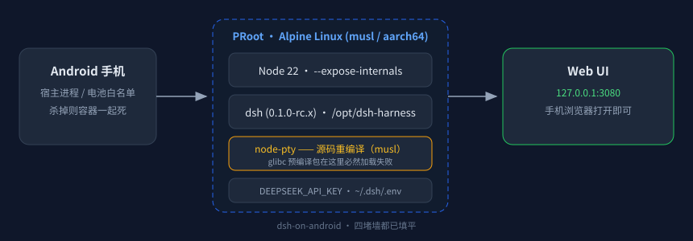

# dsh-on-android

在 **Android 手机**上跑 DeepSeek Harness（`dsh web`）—— 基于 PRoot + Alpine Linux（musl / aarch64），全程不编译 Chromium、不需要 root。



> 适用环境：任何能跑 Linux 沙箱的 Android（Minis / Termux + proot-distro Alpine / 各种 proot 容器）。
> 已在 Alpine 3.20 + Node 22 + aarch64 实测跑通，`dsh` 版本 `0.1.0-rc.7`。

---

## 为什么需要这个仓库

`npx @deepseek-ai/dsh` 在 glibc 桌面上是一行命令的事，但在 musl 环境上会连续撞四堵墙，每堵墙的报错都指向错误方向：

| 报错 | 你以为的原因 | 真实原因 |
|---|---|---|
| `Error loading shared library ld-linux-aarch64.so.1` | 缺系统库 | node-pty 下载的是 **glibc 预编译包**，musl 加载不了 |
| `--expose-internals is required for HMR` | 参数没生效 | 它**不允许**出现在 `NODE_OPTIONS` 里，只能命令行传 |
| `.env sets DSH_PERMISSION_MODE ... only the launching environment may set` | 配置格式写错了 | 这是 **bootstrap 变量**，只能由启动进程 export |
| `no sandbox backend is usable` | 权限不够 | workspace-write 模式在容器内无可用后端，要 full-access |

这份仓库把四个坑的解法固化成了脚本。

---

## 快速开始

```bash
git clone https://github.com/<you>/dsh-on-android.git
cd dsh-on-android
sh install.sh                 # 装依赖 + 装 dsh + 编译 node-pty + 固化到 /opt/dsh-harness
dsh --version                 # 应输出 0.1.0-rc.x
export DEEPSEEK_API_KEY=sk-xxxxxxxx
dsh-go                        # 启动 web UI 并打开 http://127.0.0.1:3080
```

首次进 web UI：点「继续」走 onboarding → 工作区选一个可写目录 → 界面显示 `DeepSeek-V4-Flash` 即接通。

---

## 四个坑的细节

### 1. node-pty 必须针对 musl 重编译

```bash
apk add --no-cache build-base linux-headers python3
cd <node_modules>/node-pty && npx --yes node-gyp rebuild     # 看到 "gyp info ok"
node -e "const pty=require('./lib/index.js');const p=pty.spawn('/bin/echo',['ok'],{});p.onExit(e=>{console.log('node-pty OK',e.exitCode);process.exit(0)})"
```

### 2. `--expose-internals` 只能走命令行

```sh
exec node --expose-internals /opt/dsh-harness/node_modules/@deepseek-ai/dsh/lib/bin.js "$@"
```

放进 `NODE_OPTIONS` 会直接被 Node 拒绝（安全限制），放进 `.env` 无效。

### 3. `DSH_PERMISSION_MODE` 是 bootstrap 变量

```sh
export DSH_PERMISSION_MODE=danger-full-access   # 必须在启动进程的环境里
```

写进 `/root/.dsh/.env` 会导致 **dsh 拒绝启动**。`.env` 里只应该放 `DEEPSEEK_API_KEY`。
副作用：full-access 模式下不再逐条审批 Bash 命令 —— 手机本地自用可以接受，多人/公网暴露请勿这样配。

### 4. 固化安装：PRoot 下 `cp -a` 会失败，要用 tar 流

```bash
cd /root/.npm/_npx/<hash>/node_modules
tar cf - --exclude='node-pty/build' . | (cd /opt/dsh-harness && tar xf -)
```

硬链接/权限在 PRoot 视图里会不一致，`tar` 流式复制是唯一稳的方式。详见 `install.sh`。

---

## 常用命令

| 命令 | 作用 |
|---|---|
| `dsh --version` | 检查安装 |
| `dsh-go` | 启动 web UI 并打开浏览器 |
| `dsh-go --status` | 只看是否在跑 |
| `dsh-go --browser` | 用系统浏览器打开 |
| 日志 | `~/.dsh-web.log` |

停止：`pkill -f 'dsh/lib/bin.js'`

---

## 已知限制（写在这里省得你去 issue 区问）

- **进程随宿主 App 死**：`nohup` 只能防 SIGHUP，Android 杀掉上层 App/容器，沙箱进程会一起消失。要真正常驻需要 Termux 前台服务 + 电池白名单。
- **长时间运行的会话会被回收**：手机内存紧张时浏览器标签页也会被销毁，web UI 那边正在跑的步骤可能中断。建议把长任务拆小步。
- **写文件 EPERM**：某些 proot 配置下在 `/root` 内写文件会 `Operation not permitted`，把工作区换到挂载的共享目录（如 `/sdcard/Documents/xxx`）即可。
- **不要在公网暴露 3080**：默认 `danger-full-access`，等于把 shell 送人。

---

## License

MIT
