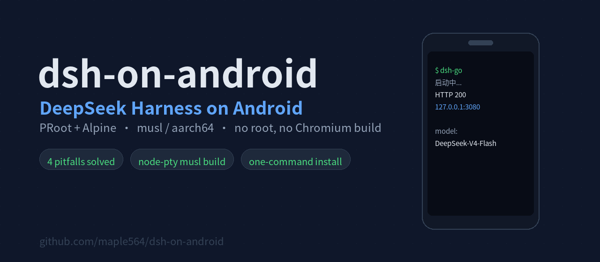
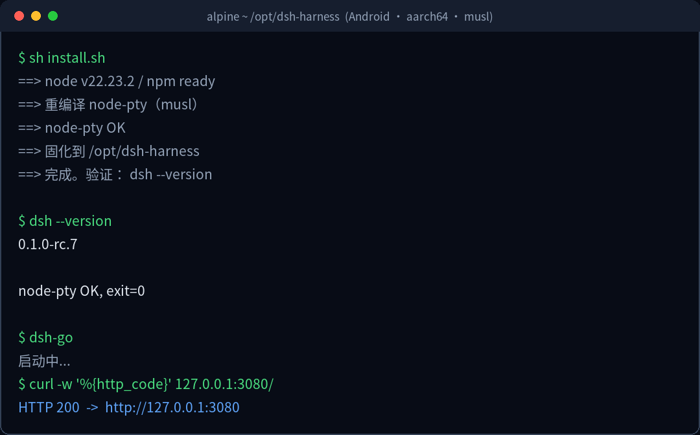
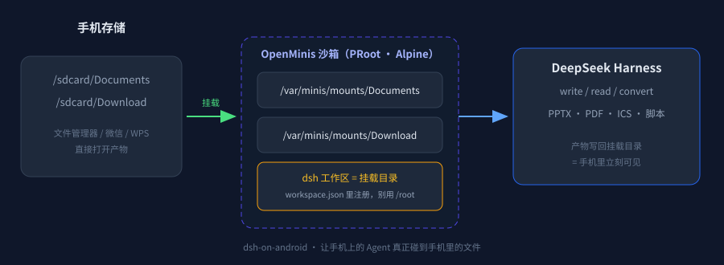

<div align="center">



# dsh-on-android

**在 Android 手机上跑 [OpenMinis](https://github.com/OpenMinis/OpenMinis)（Minis）里的 DeepSeek Harness，并把手机文件目录挂成它的工作区** —— 不用 root、不用 Termux X11、不编译 Chromium；PRoot + Alpine（musl / aarch64）四个坑已经填平。

[](#)
[](https://github.com/OpenMinis/OpenMinis)
[](#)
[](https://www.npmjs.com/package/@deepseek-ai/dsh)
[](LICENSE)
[](#贡献)

**简体中文** · [English](docs/i18n/README.en.md) · [繁體中文](docs/i18n/README.zh-TW.md) · [日本語](docs/i18n/README.ja.md) · [한국어](docs/i18n/README.ko.md)

</div>

---

## TL;DR

```bash
git clone https://github.com/maple564/dsh-on-android.git && cd dsh-on-android
sh install.sh                                  # 依赖 → dsh → 重编译 node-pty → 固化到 /opt/dsh-harness
export DEEPSEEK_API_KEY=sk-xxxxxxxx            # 或写进 ~/.dsh/.env（只放这一行）
dsh-go                                         # 打开 http://127.0.0.1:3080
```

首次进 web UI：点「继续」→ 选一个可写目录做工作区 → 顶部显示 `DeepSeek-V4-Flash` 即接通。



---

## 跑在什么上面

首次跑通的环境是 **[OpenMinis](https://github.com/OpenMinis/OpenMinis)（即 Minis，开源，GPLv3）**：它是一个把完整 Alpine Linux 沙箱塞进手机里的 Android / iOS AI Agent 应用，沙箱本身就是 PRoot + musl + aarch64 —— 也就是这个仓库要对付的那类环境。

所以：

- **在 OpenMinis 里**：装好 App，打开任意会话，让 Agent 执行 `sh install.sh` 即可；沙箱、`android-*` CLI、文件挂载都是现成的，本文档里的路径（`/var/minis/mounts/...`、`/sdcard/Documents`）就是它的挂载点。
- **不在 OpenMinis 里**：Termux + `proot-distro install alpine`、UserLAnd 等任何 PRoot 容器都适用，`install.sh` 只依赖 `apk/npm/node-gyp`。

> 为什么特意写这一节：光说「Android + PRoot」太抽象，两个报错（node-pty 的 glibc ABI、sandbox backend 缺失）都跟**宿主进程怎么起容器**有关，知道宿主是什么，排查时能少走一半弯路。

---

## 稀缺点：它不只是"跑起来了"，它能直接动你手机里的文件

电脑上跑 dsh 谁都会。**手机上跑 dsh 的价值不在 dsh，在于它坐在你的相册、下载、微信文件旁边。**



OpenMinis 会把手机存储挂到沙箱里的固定路径：

| 手机侧 | 沙箱内路径 | 你平时用来干什么 |
|---|---|---|
| `/sdcard/Documents` | `/var/minis/mounts/Documents/` | 文档、课件、下载的 PDF |
| `/sdcard/Download` | `/var/minis/mounts/Download/` | 浏览器下载、微信保存的文件 |
| 跨会话共享目录 | `/var/minis/shared/` | 多个会话共用的产物 |

于是 dsh 只要把工作区指向这些挂载目录，就变成「**能读写手机的 Agent**」：

- **产出直接落地手机**：harness 生成的 PPTX / PDF / ICS / 脚本写进 `Documents/dsh-workspace/`，退出 App 后用文件管理器、微信、WPS 直接打开，不需要"再传一次到手机"。
- **反向读手机文件**：把 `2026暑期实践报告.docx`、课表截图、发票 PDF 丢进 Documents，让 dsh 在会话里直接读、改、重新导出。
- **离线 + 私有**：模型走你的 API，文件全程不出设备。
- **随时能用**：地铁上、床上、旅行中，不用开机电脑。

### 关键一步：把工作区挂到挂载目录

dsh 默认工作区是 `/root`，在 PRoot 里写文件容易 `Operation not permitted`，而且手机根本看不到。改成挂载目录即可。

```bash
# 1. 建一个手机可见的工作区
mkdir -p /var/minis/mounts/Documents/dsh-workspace

# 2. 注册到 dsh（保留已有工作区，不覆盖）
cp ~/.dsh/storages/workspace.json ~/.dsh/storages/workspace.json.bak
python3 - <<'PY'
import json, uuid, datetime
p = json.load(open('/root/.dsh/storages/workspace.json'))
new = "/var/minis/mounts/Documents/dsh-workspace"
for ws in p["tables"]["workspaces"].values():
    if ws.get("path") == new:
        raise SystemExit("已注册，跳过")
now = datetime.datetime.now(datetime.timezone.utc).isoformat().replace("+00:00", ".000Z")
wid = "ws-" + uuid.uuid4().hex[:12]
p["tables"]["workspaces"][wid] = {"path": new, "title": "dsh-workspace",
                                  "sessionIds": [], "createdAt": now, "updatedAt": now}
p["global"]["workspaceIds"].append(wid)
json.dump(p, open('/root/.dsh/storages/workspace.json', 'w'), indent=2, ensure_ascii=False)
print("注册成功", wid)
PY

# 3. 重启 harness，UI 侧边栏里选 dsh-workspace 新建会话
pkill -f 'dsh/lib/bin.js'; sleep 2; dsh-go
```

**验证**：在新会话里让 agent 写一个 `hello.txt`，然后用手机文件管理器打开 `Documents/dsh-workspace/` —— 文件就在那儿。

> 这和「在电脑上跑一个本地 Agent」是两件事：电脑上的 Agent 要动手机文件得靠微信传、网盘同步、数据线；挂在 OpenMinis 挂载点上的 dsh，读写手机文件就是一次普通的 `open()`。

---

## 为什么需要这个仓库

`npx @deepseek-ai/dsh` 在 glibc 桌面上是一行命令的事，但在 musl 环境里会连续撞四堵墙 —— 而且**每一堵墙的报错都指向错误方向**，能让人白折腾两天。

| # | 你会看到的报错 | 你以为的原因 | 真实原因 | 解法 |
|---|---|---|---|---|
| 1 | `Error loading shared library ld-linux-aarch64.so.1` | 缺系统库 | node-pty 拿的是 **glibc 预编译包**，musl 加载不了 | `node-gyp rebuild` |
| 2 | `--expose-internals is required for HMR` | 参数没生效 | 该参数**不允许**出现在 `NODE_OPTIONS` 里 | 只能命令行传给 node |
| 3 | `.env sets DSH_PERMISSION_MODE ... only the launching environment may set` | .env 格式写错 | 它是 **bootstrap 变量**，只认启动进程的环境 | 写进 wrapper 的 `export` |
| 4 | `no sandbox backend is usable` | 权限不够 | 容器内 workspace-write 无可用后端 | `DSH_PERMISSION_MODE=danger-full-access` |

这个仓库把四条解法固化成了 `install.sh` + 两个 wrapper，装完即用。

---

## 环境要求

| 项 | 要求 |
|---|---|
| 宿主 | Android 10+（已在 Android 16 / aarch64 实测） |
| 容器 | 任意 PRoot Linux：**OpenMinis / Minis 沙箱**、`proot-distro install alpine`、UserLAnd 等 |
| 发行版 | Alpine 3.20+（musl）或任意 glibc 发行版（脚本会自动跳过重编译） |
| Node | ≥ 20（实测 22.23.2） |
| 磁盘 | 约 800 MB（依赖树较大） |
| Root | **不需要** |

---

## 四个坑的细节

<details open>
<summary><b>1. node-pty 必须针对 musl 重编译</b></summary>

```bash
apk add --no-cache build-base linux-headers python3
cd <node_modules>/node-pty && npx --yes node-gyp rebuild      # 看到 "gyp info ok" 即成功
# 自检
node -e "const pty=require('./lib/index.js');const p=pty.spawn('/bin/echo',['ok'],{});p.onExit(e=>{console.log('node-pty OK',e.exitCode);process.exit(0)})"
```

`prebuilds/linux-arm64/pty.node` 是 glibc ABI 的，musl 下 `ld-linux-aarch64.so.1` 根本不存在，所以必然失败。
</details>

<details>
<summary><b>2. <code>--expose-internals</code> 只能走命令行</b></summary>

```sh
exec node --expose-internals /opt/dsh-harness/node_modules/@deepseek-ai/dsh/lib/bin.js "$@"
```

- 放进 `NODE_OPTIONS` → Node 直接拒绝（安全限制，不是 dsh 的问题）
- 写进 `.env` → 无效，`.env` 只影响 dsh 自己的配置
</details>

<details>
<summary><b>3. <code>DSH_PERMISSION_MODE</code> 是 bootstrap 变量</b></summary>

```sh
export DSH_PERMISSION_MODE=danger-full-access    # 必须在启动进程的环境里
```

写进 `~/.dsh/.env` 会让 **dsh 拒绝启动**（它故意这么设计，防止用配置文件悄悄提权）。
副作用要说清楚：full-access 模式下**不再逐条审批 Bash 命令**。手机本地自用可以接受，**绝对不要把 3080 暴露到公网**。
</details>

<details>
<summary><b>4. 固化安装：PRoot 下 <code>cp -a</code> 会失败，要用 tar 流</b></summary>

```bash
cd /root/.npm/_npx/<hash>/node_modules
tar cf - --exclude='node-pty/build' . | (cd /opt/dsh-harness && tar xf -)
```

npx 缓存在 PRoot 里存在硬链接/权限视图不一致，`cp -a` 会报错；`tar` 流式复制是唯一稳的方式。
复制完要把铺平的目录再包一层 `node_modules/`，否则 `require` 解析不到 —— `install.sh` 里已经处理。
</details>

---

## 常用命令

| 命令 | 作用 |
|---|---|
| `dsh --version` | 检查安装是否成功 |
| `dsh-go` | 启动 web UI 并打开浏览器 |
| `dsh-go --status` | 只看是否在跑（不启动） |
| `dsh-go --browser` | 用系统浏览器打开 |
| `pkill -f 'dsh/lib/bin.js'` | 停止 |
| `~/.dsh-web.log` | 日志 |

---

## 常见问题

**Q：装完 `dsh --version` 报 `Cannot find module`？**
`/opt/dsh-harness` 目录层级不对。确认结构是 `/opt/dsh-harness/node_modules/@deepseek-ai/dsh/lib/bin.js`；`install.sh` 第 4 步如果中途失败会留下平铺结构。

**Q：web UI 打开是白屏？**
两种可能：① 用的浏览器内核不支持 Canvas/WebGL（部分 App 内置 WebView 会白屏，但 DOM 和交互其实正常，换 Chrome 即可）；② 服务没起来 —— 先 `curl -o /dev/null -w '%{http_code}' http://127.0.0.1:3080/`，返回 000 就是没启动。

**Q：在 `/root` 里写文件 `Operation not permitted`？**
PRoot 视图问题，不是权限。把工作区换成挂载的共享目录（如 `/sdcard/Documents/dsh-workspace`）即可。

**Q：App 退到后台就被杀了？**
`nohup` 只防 SIGHUP，宿主进程死了沙箱一定跟着死。真保活要 Termux 前台服务 + 电池白名单（不同厂商设置路径不同）。

**Q：能不能跑在 Termux 原生环境（不装 PRoot）？**
能，而且更稳（bionic 有完整 syscall）。但 node-pty 仍需按 Termux 环境编译，`install.sh` 的编译段可以复用。

---

## 已知限制

- **进程生命周期绑宿主**：Android 杀 App/容器，dsh 一起消失，任务可能中断。建议把长任务拆成小步。
- **长时间会话会被回收**：内存紧张时浏览器标签页销毁，前端与后端的连接断，需要刷新重连。
- **性能**：PRoot 有 syscall 翻译开销，初次 `npm install` 明显慢于桌面；跑起来后 web UI 交互基本无感。
- **不要在公网暴露 3080**：默认 full-access，等于把 shell 交出去。

---

## 贡献

踩到新的坑 / 换机型跑通 / 适配别的 PRoot 发行版，都欢迎提 PR。
提 issue 请带上：`uname -a`、`node -v`、`dsh --version`、完整报错原文。

---

## English

`dsh-on-android` documents and scripts a working **DeepSeek Harness** setup on **Android via PRoot + Alpine (musl / aarch64)** — no root, no Chromium build. First brought up inside **[OpenMinis](https://github.com/OpenMinis/OpenMinis)** (the open-source mobile AI-agent app that ships an on-device Alpine sandbox); any PRoot container works too. It encodes fixes for four misleading failures: glibc-prebuilt `node-pty`, `--expose-internals` being rejected inside `NODE_OPTIONS`, `DSH_PERMISSION_MODE` being a bootstrap-only variable, and the missing sandbox backend in containers. Run `sh install.sh && dsh-go`.

## License

[MIT](LICENSE)
