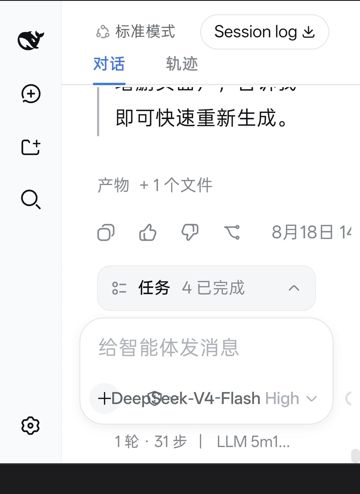

<div align="center">


# dsh-on-android

**Run DeepSeek Harness (`dsh web`) on an Android phone.** No root, no Termux X11, no Chromium build — it runs inside PRoot + Alpine (musl / aarch64), with four misleading failures already solved.

[简体中文](../README.md) · **English** · [繁體中文](README.zh-TW.md) · [日本語](README.ja.md) · [한국어](README.ko.md)

</div>

---

## What people assume vs what this actually is

"dsh on Android" sounds like **a web page you open in a browser** — you can chat, but it can't touch anything. That assumption is the whole difference:

| Where it runs | Files it can touch | Upload / sync needed | Device APIs |
|---|---|---|---|
| A hosted dsh in your browser | no filesystem at all | — | none |
| dsh on a laptop | the laptop's files | output has to be sent back to the phone | none |
| dsh on a cloud server / cloud IDE | the cloud's files | yes — files leave the device | none |
| **This: dsh inside Minis** | **your phone's Documents / Download** | **none — files never leave the device** | photos / calendar / notifications / clipboard |

The UI is identical (`http://127.0.0.1:3080`). **The difference is not the interface — it's which filesystem the harness is sitting on.**

In one line: **someone else's agent, running on your phone's files.**

---

## TL;DR

```bash
git clone https://github.com/maple564/dsh-on-android.git && cd dsh-on-android
sh install.sh                                  # deps -> dsh -> rebuild node-pty -> install to /opt/dsh-harness
export DEEPSEEK_API_KEY=sk-xxxxxxxx            # or put that single line in ~/.dsh/.env
dsh-go                                         # opens http://127.0.0.1:3080
```

First run in the web UI: hit “继续” (continue) → pick a writable workspace → the header shows `DeepSeek-V4-Flash` when the key works.


---

## Verified on a real phone

Android 16, Chrome at `http://127.0.0.1:3080` — no mock-ups:

<p align="center">


</p>

Left: the workspace screen with `DeepSeek-V4-Flash` at the bottom (model connected). Right: a real session — `对话 / 轨迹` (chat / trace) views, `产物 +1个文件` (one artefact), `任务 4 已完成` (4 tasks done), `1 轮 · 31 步` (1 turn, 31 steps).

<p align="center">

</p>

`dsh-go --status` output — and the reason this repo exists: the process line literally reads `node --expose-internals /opt/dsh-harness/.../bin.js web`, i.e. the fix for wall #2.

---

## What it runs on

The reference environment is **[OpenMinis](https://github.com/OpenMinis/OpenMinis)** (formerly Minis, open source, GPLv3) — a mobile AI-agent app that ships a full Alpine Linux sandbox on device. That sandbox *is* PRoot + musl + aarch64, i.e. exactly the kind of environment this repo is about.

- **Inside OpenMinis**: install the app, open any session, let the agent run `sh install.sh`. Sandbox, `android-*` CLIs and file mounts are already there (`/var/minis/mounts/...`, `/sdcard/Documents`).
- **Anywhere else**: Termux + `proot-distro install alpine`, UserLAnd, or any PRoot container. `install.sh` only needs `apk`, `npm`, `node-gyp`.

---

## Division of labour: Minis owns local files, dsh owns execution

<p align="center"></p>

This is not "install dsh on a phone" — it's **two layers, each doing one job**:

| | Minis (local layer) | dsh (execution layer) |
|---|---|---|
| Owns | mounting phone storage, the PRoot/Alpine sandbox, device APIs (photos, calendar, notifications, clipboard), API keys & permissions, app lifecycle | the agent loop, plan/todo decomposition, tool calls, long-task context, chat/trace views, model & reasoning effort |
| Doesn't own | how a task is decomposed, how many steps it takes | where the file finally lives, where device permissions come from |
| Guarantees | **the file is real, the device is real** | **the task is actually finished** (`1 turn · 31 steps` is countable evidence) |

There is exactly **one contract between them: the mounted directory.** Four things follow:

1. **Each does what it's good at** — you don't force Minis to run a 30-step agent loop, and you don't force dsh to figure out how to read the phone's photo library (it never could).
2. **The file is the interface** — Minis guarantees the path is real and visible to the device; dsh guarantees what lands there is correct. No sync layer, no cloud drive, no "send it over again".
3. **Observable** — on the Minis side you watch the shell process and where files actually are; on the dsh side you watch the conversation, the trace and the step count. A failure is immediately attributable to one layer.
4. **Swappable** — replace the execution layer with any other local service (Gradio, Jupyter, your own RAG app); it still works, because the contract is just "a directory and a port".

In one line: **Minis provides the real world, dsh provides the execution.**

---

## The scarce part: it doesn't just run — it can touch the files on your phone

Anyone can run dsh on a laptop. **The value of running it on a phone isn't dsh — it's that it sits right next to your photos, downloads and chat attachments.**

OpenMinis mounts phone storage into the sandbox at fixed paths:

| Phone side | Inside the sandbox | Typical use |
|---|---|---|
| `/sdcard/Documents` | `/var/minis/mounts/Documents/` | documents, lecture slides, downloaded PDFs |
| `/sdcard/Download` | `/var/minis/mounts/Download/` | browser downloads, files saved from WeChat |
| cross-session share | `/var/minis/shared/` | artefacts shared between sessions |

Point the dsh workspace at those mounts and it becomes **an agent that can read and write your phone**:

- **Output lands on the phone directly** — PPTX / PDF / ICS / scripts written to `Documents/dsh-workspace/` open immediately in a file manager, WeChat or WPS. No "transfer it to the phone again" step.
- **Read phone files in reverse** — drop a `.docx`, a timetable screenshot or an invoice PDF into Documents and let dsh read, edit and re-export it in-session.
- **Offline and private** — inference goes to your own API key; files never leave the device.
- **Available anywhere** — on the subway, in bed, while travelling.

### The one critical step: mount the workspace

dsh defaults to `/root`, which hits `Operation not permitted` under PRoot and is invisible from the phone. Switch it to a mount:

```bash
mkdir -p /var/minis/mounts/Documents/dsh-workspace
cp ~/.dsh/storages/workspace.json ~/.dsh/storages/workspace.json.bak
python3 - <<'PY'
import json, uuid, datetime
p = json.load(open('/root/.dsh/storages/workspace.json'))
new = "/var/minis/mounts/Documents/dsh-workspace"
for ws in p["tables"]["workspaces"].values():
    if ws.get("path") == new:
        raise SystemExit("already registered")
now = datetime.datetime.now(datetime.timezone.utc).isoformat().replace("+00:00", ".000Z")
wid = "ws-" + uuid.uuid4().hex[:12]
p["tables"]["workspaces"][wid] = {"path": new, "title": "dsh-workspace",
                                  "sessionIds": [], "createdAt": now, "updatedAt": now}
p["global"]["workspaceIds"].append(wid)
json.dump(p, open('/root/.dsh/storages/workspace.json', 'w'), indent=2, ensure_ascii=False)
print("registered", wid)
PY
pkill -f 'dsh/lib/bin.js'; sleep 2; dsh-go
```

**Verify**: ask the agent to write `hello.txt`, then open `Documents/dsh-workspace/` in the phone's file manager — it's there.

> This is a different thing from "a local agent on your laptop": to touch phone files a desktop agent needs WeChat forwarding, cloud sync or a USB cable. A dsh workspace mounted on OpenMinis just calls `open()`.

---

## Why this repo exists

`npx @deepseek-ai/dsh` is one line on a glibc desktop. On musl it hits four walls in a row — and **every error message points the wrong way**, which can burn two days.

| # | What you see | What you'd think | What it actually is | Fix |
|---|---|---|---|---|
| 1 | `Error loading shared library ld-linux-aarch64.so.1` | missing system library | node-pty ships a **glibc prebuilt** binary | `node-gyp rebuild` |
| 2 | `--expose-internals is required for HMR` | the flag didn't apply | it is **not allowed in `NODE_OPTIONS`** | pass it on the node command line |
| 3 | `.env sets DSH_PERMISSION_MODE ... only the launching environment may set` | malformed .env | it is a **bootstrap-only variable** | `export` it in the wrapper |
| 4 | `no sandbox backend is usable` | permission problem | no usable backend for workspace-write in containers | `DSH_PERMISSION_MODE=danger-full-access` |

This repo bakes those fixes into `install.sh` plus two wrappers.

---

## Requirements

| Item | Requirement |
|---|---|
| Host | Android 10+ (tested on Android 16 / aarch64) |
| Container | Any PRoot Linux: **OpenMinis / Minis sandbox**, `proot-distro install alpine`, UserLAnd… |
| Distro | Alpine 3.20+ (musl); any glibc distro works — the rebuild step is skipped automatically |
| Node | ≥ 20 (tested 22.23.2) |
| Disk | ~800 MB |
| Root | **not needed** |

---

## The four failures in detail

**1. node-pty must be recompiled for musl**
```bash
apk add --no-cache build-base linux-headers python3
cd <node_modules>/node-pty && npx --yes node-gyp rebuild     # wait for "gyp info ok"
```
`prebuilds/linux-arm64/pty.node` is glibc ABI; musl has no `ld-linux-aarch64.so.1`, so it can never load.

**2. `--expose-internals` only works on the command line**
```sh
exec node --expose-internals /opt/dsh-harness/node_modules/@deepseek-ai/dsh/lib/bin.js "$@"
```

**3. `DSH_PERMISSION_MODE` is a bootstrap variable**
```sh
export DSH_PERMISSION_MODE=danger-full-access    # must be in the launching process's env
```
Putting it in `~/.dsh/.env` makes dsh **refuse to start** — by design. Side effect: Bash commands are **no longer approved one by one**, so never expose port 3080 publicly.

**4. Solid install: `cp -a` fails under PRoot, use a tar stream**
```bash
cd /root/.npm/_npx/<hash>/node_modules
tar cf - --exclude='node-pty/build' . | (cd /opt/dsh-harness && tar xf -)
```

---

## Commands

| Command | Purpose |
|---|---|
| `dsh --version` | verify the install |
| `dsh-go` | start the web UI and open it |
| `dsh-go --status` | check whether it's running |
| `dsh-go --browser` | open in the system browser |
| `pkill -f 'dsh/lib/bin.js'` | stop |
| `~/.dsh-web.log` | log |

---

## FAQ

**`Cannot find module '/opt/dsh-harness/node_modules/...'`** — the dir tree got flattened. It must be `/opt/dsh-harness/node_modules/@deepseek-ai/dsh/lib/bin.js`.

**Blank page in the web UI** — ① the browser engine lacks Canvas/WebGL (some in-app WebViews render blank but the DOM still works — use Chrome); ② the server isn't up: `curl -s -o /dev/null -w '%{http_code}' http://127.0.0.1:3080/` → `000` means dead.

**`Operation not permitted` when writing files** — PRoot view mismatch, not permissions. Move the workspace to a mounted shared directory.

**Killed when sent to background** — `nohup` only survives SIGHUP. Real persistence needs a Termux foreground service plus battery-optimisation whitelist.

**Does it work in native Termux (no PRoot)?** Yes, and it's more stable (bionic has full syscalls) — but node-pty still needs compiling for that environment; reuse the compile step.

---

## Known limits

- **Process lifetime is tied to the host**: kill the app/container and dsh dies with it. Split long tasks into small steps.
- **Long sessions get reclaimed**: a memory-pressured tab may be destroyed and the front-end connection drops; refresh and reconnect.
- **Performance**: PRoot adds syscall translation overhead — the first `npm install` is noticeably slower than on desktop.
- **Never expose 3080 publicly**: default is full-access; that hands over a shell.

---

## Contributing

New pitfalls, other devices, other PRoot distros — PRs welcome. For issues please include `uname -a`, `node -v`, `dsh --version` and the full error text.

## License

[MIT](../../LICENSE)
